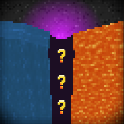

# Candycanvas

Randomize the outcome of different block events

# Dependencies

- [SuperMartijn642's Config Lib](https://modrinth.com/mod/supermartijn642s-config-lib)

# Configuration

Properties of randomization can be configured under the `config/candycanvas-Candycanvas.json` file:

- `enabled`: Global toggle for the mod.
- `shouldRandomizeStoneGeneration`: Whether to randomize the generation of blocks in place of stone.
- `shouldRandomizeObsidianGeneration`: Whether to randomize the generation of blocks in place of obsidian.
- `shouldRandomizeCobblestoneGeneration`: Whether to randomize the generation of blocks in place of cobblestone.
- `shouldRandomizeBasaltGeneration`: Whether to randomize the generation of blocks in place of basalt.